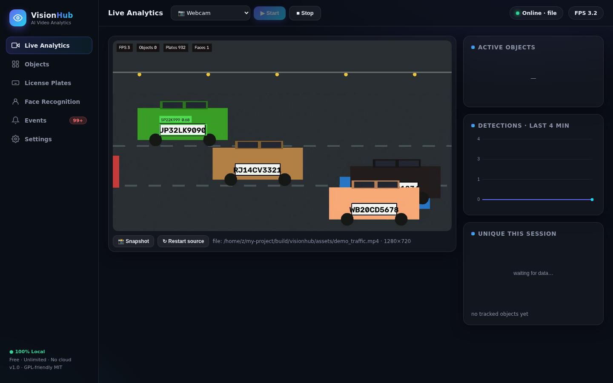
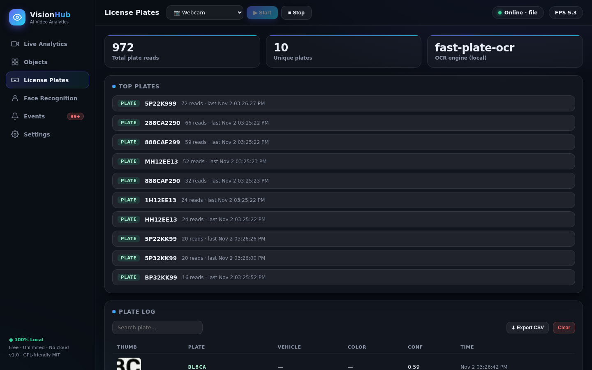

# 👁 Myeye AI — All-in-One Video Analytics




**One free, unlimited, fully-local tool that combines everything from the OpenViewer video series plus License-Plate OCR:**

| Module | What it does |
|---|---|
| 🎥 **Live Video Analytics** | YOLOv8 object detection + tracking (persons, cars, trucks, buses, motorcycles…), live MJPEG dashboard, FPS/active-object HUD |
| 🔢 **License Plate Recognition** | Automatic plate localisation + OCR (100 % offline engine chain), plate log with thumbnails, confidence, top-plates ranking, CSV export |
| 🎨 **Vehicle Colour Recognition** | Classifies every detected vehicle body colour (white / black / red / blue …) and attaches it to object + plate events |
| 👤 **Face Recognition & Face Search** | Enroll faces from photos or straight from the live stream, recognise known people on video, search any photo against the enrolled database (YuNet + SFace, runs locally) |
| 📊 **Events & Analytics** | Unified event stream with thumbnails, live charts (detections timeline, class mix), filters (category / colour / search), CSV export |
| 📷 **Sources** | Webcam, video file upload, RTSP / IP camera, bundled demo video — unlimited switching, no watermark, no cloud, no licence key |

> **100 % free · 100 % local · no account · no limits.** Every model runs on your machine; no frame ever leaves your computer.

---

## 🚀 Quick start (3 commands)

Requires **Python 3.9+** (Windows / Linux / macOS).

```bash
# 1) install dependencies (first run downloads YOLOv8n ~6 MB, face models ~38 MB, plate-OCR ~2 MB)
pip install -r requirements.txt

# 2) run
python run.py

# 3) the dashboard opens automatically at  http://127.0.0.1:8000
```

Or double-click **`setup.bat`** (Windows) / run **`./setup.sh`** (Linux/macOS) — they create a virtual
environment, install everything and start the app.

## 🖥 Using the dashboard

1. **Start a source** — top bar: *Webcam*, *Video file* (uploaded in-browser), *RTSP / IP camera* URL, or the **Demo traffic video** bundled in `assets/`.
2. **Live Analytics** — real-time annotated stream, active/unique counters, detections timeline and class-mix charts.
3. **Objects** — every tracked object as a card (thumbnail, class, colour badge, track id, time) with Human/Vehicle/Colour filters — like OpenViewer's Object Analysis page.
4. **License Plates** — plate log (thumbnail, plate text, vehicle, colour, confidence, time), top-plates ranking, CSV export, search.
   - *Vehicle mode*: plates are searched **inside detected vehicles** (traffic scenes).
   - *Plate close-up mode* (Settings): plates are searched on the **whole frame** — ideal when the camera already points at plates (parking/parking-gate cameras). The demo video works best with this mode; the app switches automatically when no vehicle is detected.
5. **Face Recognition** — enroll a person with 1–5 photos (or *Capture from live stream*), then they are named on the video. *Face search* finds the best match for any uploaded photo.
6. **Events** — unified feed of everything (objects / plates / faces) with filters and CSV export.
7. **Settings** — confidence, model size (n/s/m), module on/off switches, plate mode, face threshold, loop files, system info.

## 🔧 How it stays 100 % free & local

| Task | Engine | Licence |
|---|---|---|
| Object detection / tracking | [Ultralytics YOLOv8](https://docs.ultralytics.com/) (AGPL-3.0 — free for personal/research use) | free |
| Face detection | [OpenCV YuNet](https://github.com/opencv/opencv_zoo) (ONNX, ~230 KB) | Apache-2.0 |
| Face recognition / search | [OpenCV SFace](https://github.com/opencv/opencv_zoo) (ONNX, ~37 MB) | Apache-2.0 |
| Plate OCR | [fast-plate-ocr](https://github.com/ankandrew/fast-plate-ocr) (ONNX, ~2 MB, auto-download) → optional [EasyOCR](https://github.com/JaidedAI/EasyOCR) → optional Tesseract | free |
| Vehicle colour | pure OpenCV/HSV analysis | — |

All weights are downloaded **once** into `data/models/` from their official GitHub sources and then work
fully offline.

**Optional upgrades (still free & local):**
```bash
pip install easyocr          # stronger plate OCR (~2 GB with torch)
# or install the Tesseract binary and pip install pytesseract
```

## 📁 Project layout

```
myeye/
├── run.py                  # launcher (python run.py --port 8000)
├── requirements.txt
├── setup.bat / setup.sh    # one-click install + run
├── backend/
│   ├── app.py              # FastAPI: streaming + REST API
│   ├── config.py           # settings & paths
│   ├── db.py               # SQLite (events + face DB)
│   └── vision/
│       ├── detector.py     # YOLOv8 + IoU fallback tracker
│       ├── plates.py       # plate localisation + OCR chain
│       ├── colors.py       # vehicle colour recognition
│       ├── faces.py        # YuNet + SFace (auto-download)
│       └── pipeline.py     # real-time engine (threads, events, HUD)
├── web/                    # modern dark UI (vanilla HTML/CSS/JS, no build step)
└── assets/demo_traffic.mp4 # demo video for instant testing
```

## 🛠 Troubleshooting

| Symptom | Fix |
|---|---|
| "detector unavailable" in Settings | `pip install ultralytics` (check it installed for the same Python you run `run.py` with) |
| OCR column says "not installed" | `pip install fast-plate-ocr[onnx]` (already in requirements) or `pip install easyocr` |
| Face engine "download failed" | check internet once — models land in `data/models/`; then restart |
| RTSP timeout | test the URL in VLC first; use `rtsp://user:pass@ip:554/…` |
| Webcam busy | close other apps (Zoom/Teams) or change index in `backend/app.py → api_source` |
| Port busy | `python run.py --port 8080` |

**Privacy note:** the app binds to `127.0.0.1` only. To view the dashboard from another device on your
LAN: `python run.py --host 0.0.0.0` (only on trusted networks).

## 📜 Licence

MIT — use it, modify it, deploy it. Unlimited. (The bundled YOLO weights follow Ultralytics' AGPL licence.)
